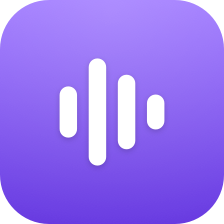
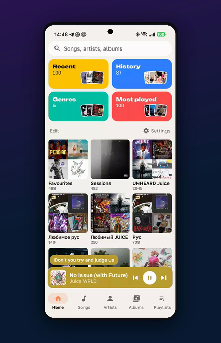
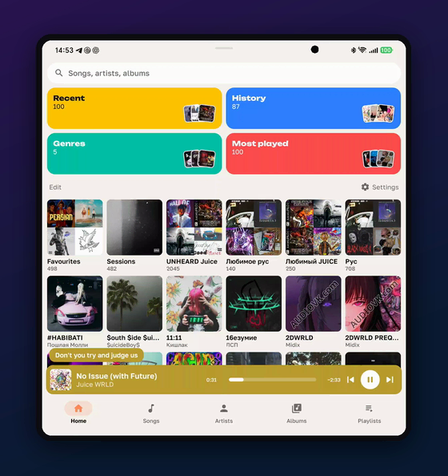
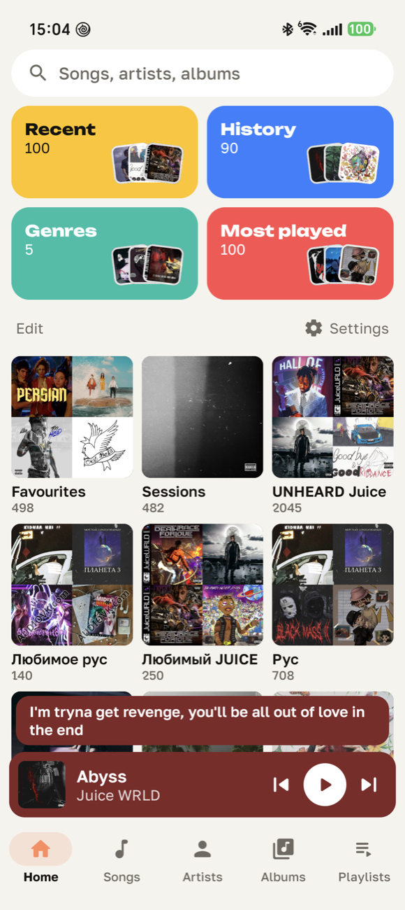
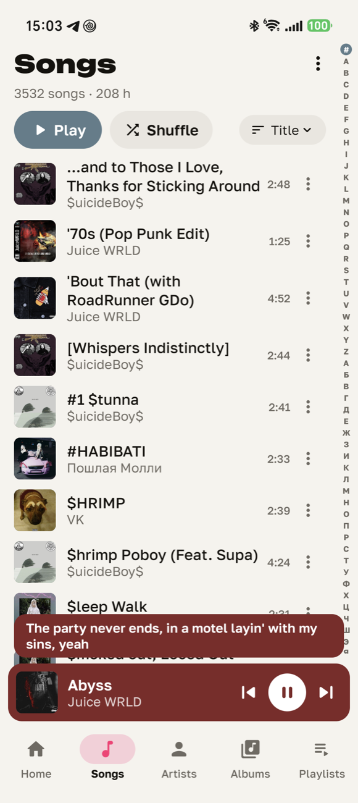
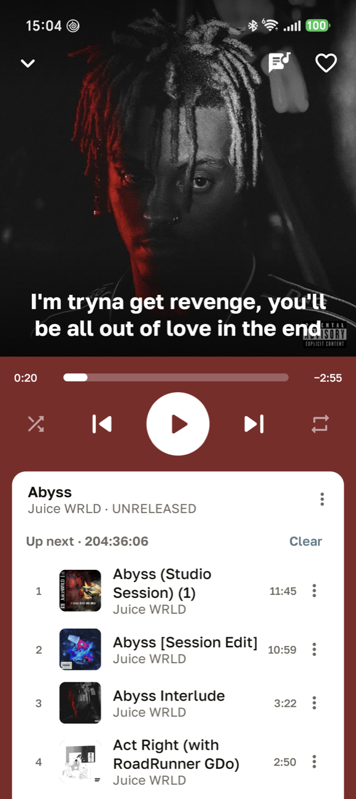
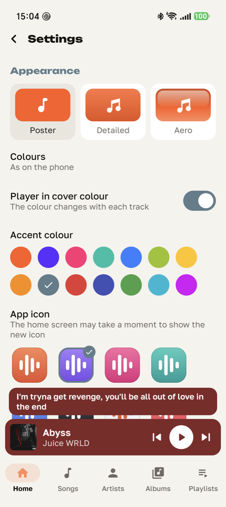
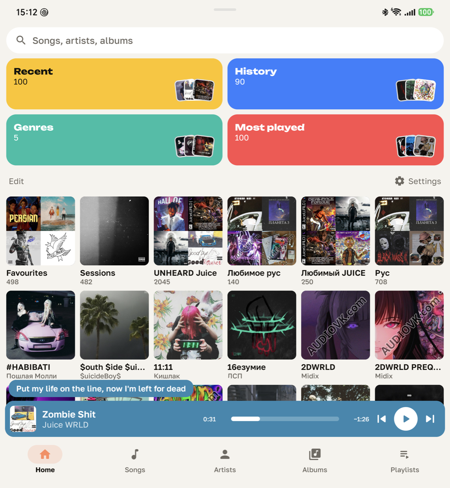
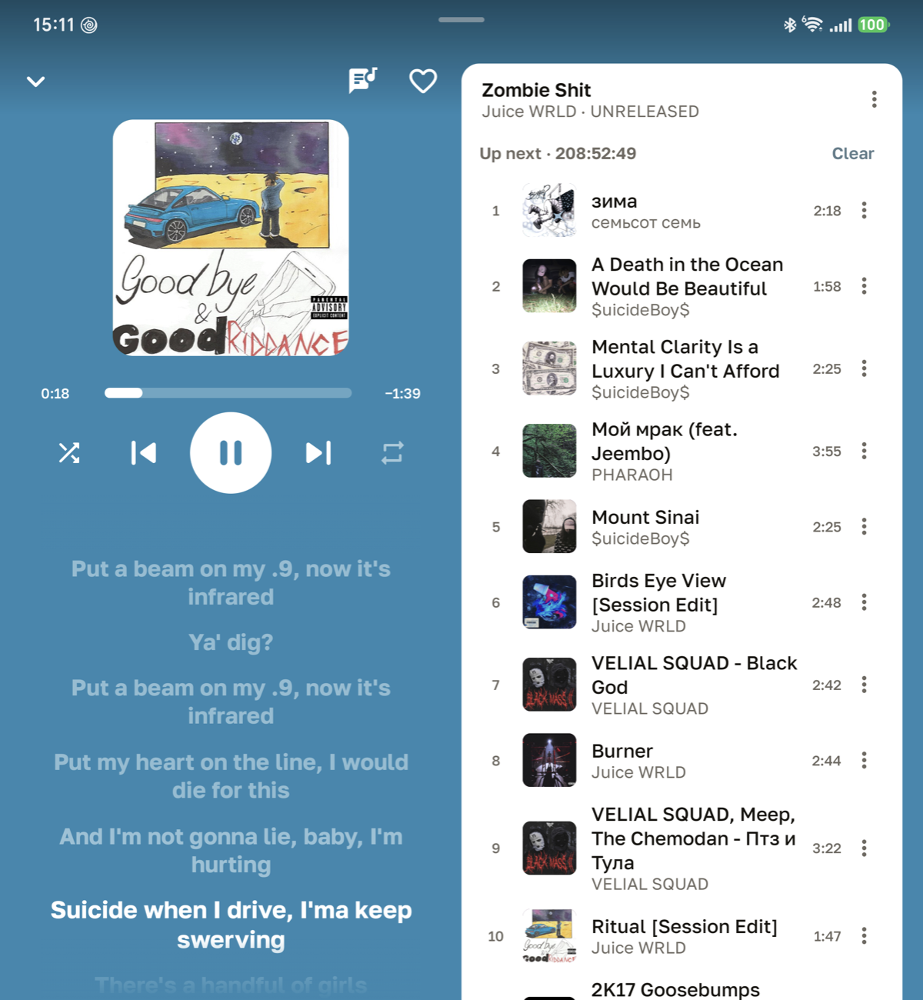
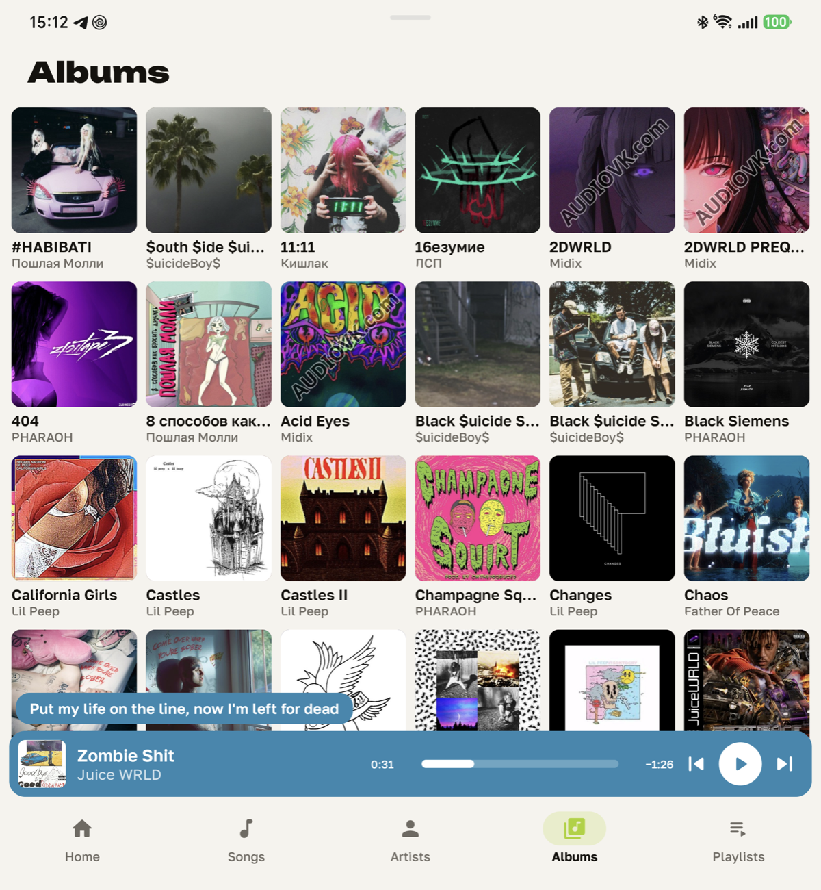

<p align="center">
  
</p>

<h1 align="center">Muz On</h1>

<p align="center">
  <b>A full music player for Android that brings your Apple Music library with it.</b><br>
  Your own files, your Mac's playlists in the same order, smart playlists that keep following their rules,<br>
  hearts that go back to Music on the Mac, all in a bold, fast interface made for foldables too.
</p>

<p align="center">
  
  
  
  
  
  
  <a href="LICENSE"></a>
</p>

<table align="center">
  <tr>
    <td align="center"></td>
    <td align="center"></td>
  </tr>
  <tr>
    <td align="center"><sub>Phone screen</sub></td>
    <td align="center"><sub>Inner screen of a foldable</sub></td>
  </tr>
</table>

## About

Muz On plays the music files on your phone. It is a complete player on its own: library, queue, lyrics, playlists, a notification with controls, and settings for how all of it behaves.

It also does something no other Android player does. It reads the library of **Music on the Mac (formerly iTunes)**, the `Library.musicdb` file itself, so the phone shows the library you already curated:

- every playlist, with the same tracks in the same order;
- smart playlists that keep following the rules you set on the Mac;
- the same artists, albums and favourites.

A heart set on the phone goes back to Music on the Mac. The iTunes library of an older computer can be rebuilt from the same data.

No account, no cloud, no ads, no analytics.

## Highlights

**Your Apple Music library, exactly.** All playlists match the Mac track for track. An MP3 entry plays its FLAC copy when that is the file on the phone.

**Smart playlists that stay smart.** The rules of each smart playlist are evaluated on the phone: favourite, artist, album, genre, year, play count, name and nested groups. Heart a song, and a playlist such as "Favourite Juice WRLD" updates at once, by the Mac's own rules.

**A player like a card.** The cover is in front, with the sung line of the lyrics on it. The queue sits on a card below, numbered both ways from the current track, and scrolling stops at the current track. One swipe folds the player into the mini player, and its buttons fly to their places there.

<table align="center">
  <tr>
    <td align="center"></td>
    <td align="center"></td>
  </tr>
</table>

**Lyrics that keep up.** Timed lyrics come from the files or from a `.lrc` file beside them. The sung line stays in view, is lit a moment early, and comes straight back after a seek. Bluetooth delay is taken into account.

**Made for foldables.** On the inner screen the player has two columns: artwork, controls and half a screen of lyrics on the left, the queue on the right. Tabs stay at the bottom, as on a tablet.

**Smooth at your screen's top rate.** Animations run at 120 Hz or more. Tabs swipe sideways, a second tap on a tab glides its list to the top, and back always returns to where you came from.

## Screens

| Phone: home | Phone: songs | Phone: player | Phone: settings |
|:--:|:--:|:--:|:--:|
|  |  |  |  |

| Inner screen: home | Inner screen: player with lyrics | Inner screen: albums |
|:--:|:--:|:--:|
|  |  |  |

## Features

### Library

- Reads Music's `Library.musicdb`, the encrypted, compressed database Music writes on the Mac.
- Playlists in their exact order, from the order file Music shows.
- Smart playlists evaluated on the phone, so changes made on the phone follow the rules.
- Artists and albums grouped as Music groups them, album artist first.
- Covers from each track's own tags; an online lookup only for tracks that have none.
- The library folder is `Music/Music Library.musiclibrary` by default; any other folder can be chosen in Settings.
- Songs whose file is not on the phone are hidden and not counted; a setting shows them.
- Files added or deleted on the phone show up by themselves.
- Without a Mac library, Muz On plays the files on the phone and keeps Favourites and your playlists as M3U8 files in `Music/Playlists`.

### Playback

- Media3 ExoPlayer: gapless playback, speed, skip silence, sleep timer.
- Play next and add to queue, kept right under shuffle; shuffle starts with the track you chose.
- Remove from the queue, or clear it.
- Shuffle, repeat and the whole queue come back after a restart.
- Hold previous or next to seek by a step you choose; swipe the cover to change track.
- A heart in the notification and on the lock screen.
- Pause or lower the volume for short sounds such as messages and navigation.
- Resume when headphones connect; keep playing when the app is swiped away.
- Files that cannot play are skipped.

### Lyrics

- Timed (LRC) and plain lyrics from the tags, or from a `.lrc` file next to the song.
- The sung line on the cover, in a bubble above the mini player, in the two-column player and in a lyrics window.
- Tap a line to jump to it; select and copy the text.
- No lyrics, no lyrics button.

### Browsing

- Home with search on top and tiles with covers: Playlists, Artists, Albums, Songs, Recent, Genres, History, Most played, Folders.
- Sort any list by title, artist, album, year, date added, duration or genre, either way round.
- An alphabet along lists sorted by name: touch a letter or slide along it.
- Your own playlists: create them, add songs from any menu, rename and delete them.
- Long press or ⋮ on everything: play, play next, add to queue, add to playlist, go to album or artist, share the file, track details.

### Make it yours

- Home: add, hide, drag and resize tiles.
- Tabs: reorder or hide them; open on Home or on the last tab.
- Three themes: Poster (flat and bold), Detailed (colourful drawn icons) and Aero (glossy).
- Light, dark or black; 14 accent colours; a player tinted with each cover's colour.
- Ten launcher icons.
- 14 languages: English, Russian, Ukrainian, German, French, Spanish, Portuguese (Brazil), Italian, Polish, Turkish, Dutch, Japanese, Korean, Chinese.

## Your Mac library on the phone

Music keeps its library in `~/Music/Music/Music Library.musiclibrary` on the Mac. With the phone connected over USB (adb), run:

```bash
tools/sync-library.sh
```

The script:

1. applies the hearts you set on the phone to Music on the Mac, which then updates its smart playlists itself;
2. writes `playlist-order.txt`, the order each playlist shows in Music (Music keeps that sort in macOS settings, not in the library);
3. copies `Library.musicdb` and the order file to `Music/Music/Music Library.musiclibrary` on the phone.

In Muz On, choose the `Music` folder once; Settings → Music library points it at another folder.

A track is matched to its file on the phone by path, by name, or by its MP3/FLAC twin. The database format is undocumented and may change with an update of Music; if it cannot be read, Muz On falls back to the files on the phone.

## An old iTunes library

`tools/itunes/itl.py` rebuilds an `iTunes Library.itl` (iTunes 12 on Windows) from the Music library: every song, every playlist in the same order, hearts and play counts, with paths mapped to the Windows drive. See [tools/itunes/README.md](tools/itunes/README.md). Keep a copy of the old file; iTunes itself has to open the new one to confirm it.

## Permissions

| Permission | What it is for |
|:--|:--|
| `READ_MEDIA_AUDIO` (`READ_EXTERNAL_STORAGE` before Android 13) | find and play your music files |
| Folder access (Storage Access Framework) | read the library copy and keep playlist files in the folder you choose |
| `FOREGROUND_SERVICE`, `FOREGROUND_SERVICE_MEDIA_PLAYBACK`, `WAKE_LOCK` | keep the music playing with the screen off |
| `POST_NOTIFICATIONS` | the playback notification |
| `INTERNET` | only to find a missing cover by artist and title (Deezer, iTunes Search); it can be switched off |

## Building

JDK 25 runs Gradle; `compileSdk` is 37, `targetSdk` 36, `minSdk` 30 (Android 11).

```bash
./gradlew :app:assembleRelease
```

Release signing reads `release.keystoreFile`, `release.keystorePassword`, `release.keyAlias` and `release.keyPassword` from `~/.gradle/gradle.properties`.

A check against a real library runs as a unit test. Point `MUZON_CHECK` at a folder with a copy of `Library.musicdb`, the `music-order.txt` written by `tools/playlist-order.applescript`, and a `phone-files.txt` list of the phone's music files:

```bash
MUZON_CHECK=/path/to/check ./gradlew :app:testDebugUnitTest
```

Launcher icons are drawn on a Mac by `tools/icon/make_icons.m`; translations live in `tools/gen_strings.py`.

## Project layout

| Path | What is there |
|:--|:--|
| `data/MusicDb.kt` | reads `Library.musicdb`: decryption, sections, tracks, playlists |
| `data/SmartRules.kt` | evaluates smart playlist rules |
| `data/PathResolver.kt` | matches library entries to files on the phone |
| `data/LibraryRepository.kt` | builds the library: hearts, own playlists, filters |
| `playback/` | the Media3 service, queue and notification |
| `ui/` | Compose screens, the player, themes |
| `tools/` | library sync, playlist order, iTunes library, icons, translations |

## Licence

MIT, see [LICENSE](LICENSE). Built with [Media3](https://developer.android.com/media/media3), [Jetpack Compose](https://developer.android.com/compose), [Coil](https://coil-kt.github.io/coil/) and [jaudiotagger](https://github.com/chr56/jaudiotagger). Fonts: Unbounded and Golos Text under the SIL Open Font License, see `docs/licenses`.

Muz On is not affiliated with Apple. Music and iTunes are trademarks of Apple Inc.
